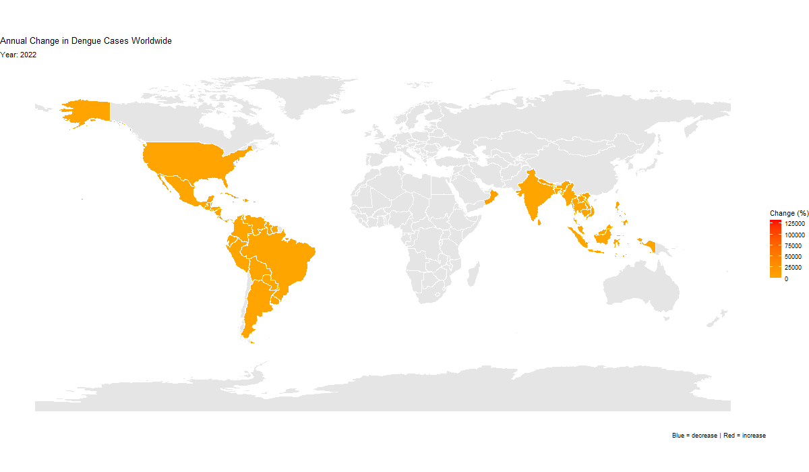
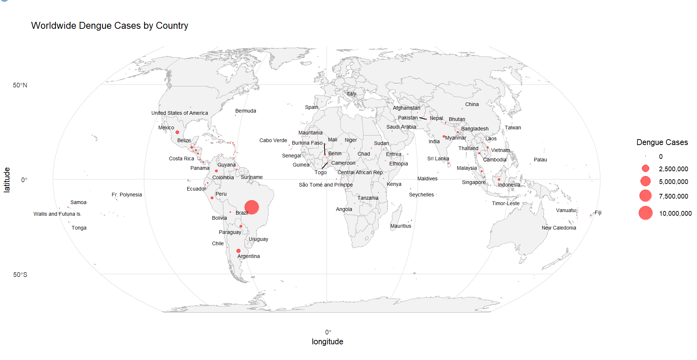

# Global Burden & Spatial Visualization of Dengue Fever

An R geospatial analysis tracking global dengue fever occurrence and annual percentage changes over time.

---

## Annual Change in Dengue Cases (2022–2025)

  

## Spatial Distribution Overview

  

---

## Repository Structure
* `dengue_global_burden.Rmd` — R Markdown source code for data processing, spatial mapping, and animation.
* `dengue_global_burden.nb.html` — Rendered R Notebook output.
* `dengue_spatial.PNG` — Static global distribution map.
* `file2ccc57524d92.gif` — Animated map showing year-over-year percentage changes.

## Key Methods & Packages
* **Spatial Handling:** `sf`
* **Data Wrangling:** `dplyr`
* **Visualization & Animation:** `ggplot2`, `gganimate`, `ggrepel`, `gifski`
*
